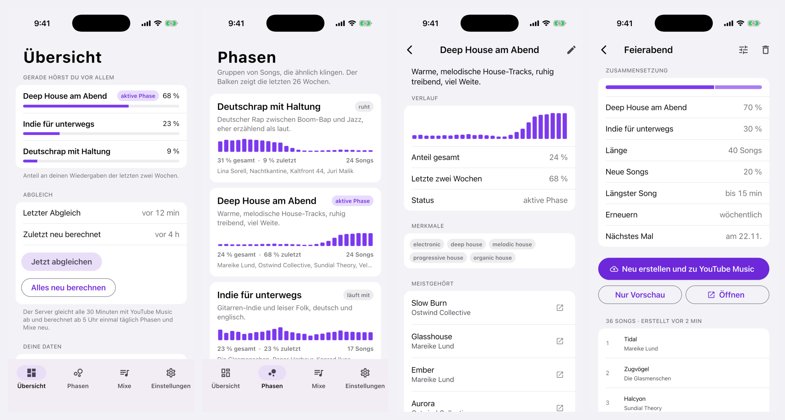

# Taktgefühl

Ein kleiner Server für das NAS, der im eigenen YouTube-Music-Verlauf **Hör-Phasen** erkennt (die Hip-Hop-Phase vom Frühjahr, die Deep-House-Phase von jetzt) und daraus Mix-Playlists direkt in YouTube Music pflegt, z. B. „30 % Hip-Hop, 70 % Elektronik, davon 20 % neue Songs“. Bedient wird er über eine eigene Android-App, gehört wird weiter in der normalen YouTube-Music-App.

*A small self-hosted server that finds listening phases in your YouTube Music history and keeps mix playlists in YouTube Music up to date, with its own Flutter app. The UI is German.*



*Die Screenshots zeigen eine Demo-Bibliothek mit erfundenen Interpreten und Songs.*

> **Vorab:** Taktgefühl nutzt die inoffizielle YouTube-Music-Schnittstelle ([ytmusicapi](https://github.com/sigma67/ytmusicapi)) und lädt für die Klang-Analyse kurz Audio von YouTube ([yt-dlp](https://github.com/yt-dlp/yt-dlp)). Beides sind inoffizielle Werkzeuge und können bei Änderungen durch YouTube zeitweise ausfallen.

## Was es kann

- **Verlauf sammeln:** YouTube Music zeigt nur die letzten paar hundert Songs, ohne Uhrzeit. Der Server fragt alle 30 Minuten nach, speichert neue Wiedergaben dauerhaft und baut so über die Zeit einen eigenen Verlauf auf. Ältere Jahre kommen über Google Takeout dazu.
- **Songs einordnen:** Mit Anthropic-Key ordnet Claude jeden Song einzeln ein (Genres, Stimmung, Klang, Energie, Sprache). Ohne Key schlägt der Server die Genres der Interpreten bei MusicBrainz nach.
- **Klang hören:** Der Server hört jeden Song einmal kurz an (drei 10-Sekunden-Ausschnitte) und bildet mit dem Modell Discogs-EffNet des [Essentia-Projekts](https://essentia.upf.edu) einen Klang-Fingerabdruck, unabhängig von Genre-Etiketten. Das Audio wird sofort wieder gelöscht.
- **Phasen finden:** Songs mit ähnlichem Klang und ähnlichen Merkmalen werden zu Gruppen. Pro Gruppe gibt es den Anteil am Hören über 26 Wochen; läuft eine Gruppe gerade deutlich mehr als sonst, ist sie eine **aktive Phase**. Ein Song, der dich packt, zählt für sich, egal wie viel du sonst vom Interpreten hörst. Die KI benennt die Phasen, eigene Namen bleiben erhalten.
- **Mixe pflegen:** Songs werden je Phase nach Anteil gezogen: oft gehört und geliked zählt mehr, kürzlich gespielt weniger, höchstens 3 Songs pro Interpret. Neue Songs kommen aus dem YouTube-Radio und werden nur genommen, wenn sie klanglich zur Phase passen. Die Playlist „Taktgefühl: <Name>“ (privat) wird in YouTube Music angelegt und jeden Morgen erneuert.
- **Eigene Hörgewohnheit bleibt sauber:** Was du über einen Taktgefühl-Mix hörst, zählt nicht als eigener Geschmack.
- **Startseite:** Der Server zeigt im Browser eine kleine Seite mit dem App-Download.

## Was du brauchst

- Ein NAS oder einen Rechner mit Docker. Gebaut und getestet ist es nur für x86/amd64.
- Ein YouTube-Music-Konto mit eingeschaltetem Wiedergabeverlauf.
- Optional einen [Anthropic-API-Key](https://console.anthropic.com) für die Einordnung durch Claude. Die Kosten zeigt die App pro Monat an.
- Für die App: [Flutter](https://flutter.dev) mit Android SDK, um sie selbst zu bauen.

## Server einrichten

### Mit Docker Compose

1. In `server/docker-compose.yml` das erste Passwort eintragen (oder die Zeile löschen, dann steht ein Zufallspasswort einmalig im Container-Protokoll).
2. Starten:

   ```bash
   cd server && docker compose up -d --build
   ```

3. Test: `http://<NAS-IP>:8390/api/health` liefert `{"ok":true,…}`.

Der erste Build lädt das Klang-Modell von essentia.upf.edu.

### Fertiges Image

Ein fertiges Server-Image (ohne App) wird bei jeder Version gebaut: `ghcr.io/hendrikheidsiek/taktgefuehl`. Eine Klick-Anleitung für UGREEN-NAS steht in [docs/EINRICHTUNG-UGREEN.md](docs/EINRICHTUNG-UGREEN.md); auf anderen NAS mit Docker-Oberfläche funktioniert es genauso.

### Einstellungen (Umgebungsvariablen)

| Variable | Standard | Bedeutung |
|---|---|---|
| `ADMIN_PASSWORD` | zufällig | Passwort für die App, nur beim allerersten Start; danach in der App ändern |
| `TZ` | `Europe/Berlin` | Zeitzone für Verlauf und Zeitplan |
| `SYNC_MINUTES` | `30` | wie oft der Verlauf abgeglichen wird |
| `REBUILD_HOUR` | `5` | Stunde, in der Phasen und Mixe neu berechnet werden |
| `ANTHROPIC_API_KEY` | – | statt in der App einzutragen |
| `AI_MODEL` | `claude-opus-5-5` | Claude-Modell für die Einordnung, in der App umstellbar |
| `YT_CLIENT_ID` / `YT_CLIENT_SECRET` | – | Google-Zugang (siehe unten), statt in der App einzutragen |
| `SOUND` | `1` | `0` schaltet die Klang-Analyse ab (dann kein Audio-Download) |
| `SOUND_THREADS` | `2` | CPU-Kerne für die Klang-Analyse |
| `PUID` / `PGID` | – | Benutzer, unter dem der Server läuft |
| `PUBLIC_URL` | – | eigene Adresse, für Link-Vorschau und QR-Code der Startseite |
| `OPERATOR_NAME` / `OPERATOR_URL` | – | optionale Zeile „Betreiber dieser Seite“ auf der Startseite |

**Passwort vergessen?** Eine Datei `passwort-zuruecksetzen.txt` mit dem neuen Passwort in den Datenordner (`/data`) legen. Der Server übernimmt es innerhalb einer halben Minute, löscht die Datei und meldet alle Geräte ab.

### Von außen erreichbar machen

Hinter einen Reverse Proxy (z. B. Nginx Proxy Manager) mit HTTPS stellen. Der Server liest die weitergereichten Header (`X-Forwarded-Proto`, `Host`), `PUBLIC_URL` ist dann meist nicht nötig.

Sicherheit: Alles außer Startseite, `/api/health` und `/api/app` braucht das Passwort. Es wird mit scrypt gespeichert, Anmelde-Tokens nur als Hash, und Fehlversuche werden gebremst. Die Zugänge zu YouTube und Anthropic liegen nur auf deinem Server.

## Zugänge einrichten

Alles weitere geht in der App: Server-Adresse und Passwort eingeben, dann unter **Einstellungen** die Zugänge eintragen.

### YouTube Music: mit Google verbinden (empfohlen)

Der Server meldet sich wie ein Fernseher an: Die App zeigt einen Code, du bestätigst ihn auf google.com/device, der Server erneuert die Anmeldung danach selbst. Dafür braucht es einmalig ein eigenes, kostenloses Google-Cloud-Projekt (etwa 10 Minuten):

1. https://console.cloud.google.com → oben Projekt auswählen → **Neues Projekt**, Name z. B. „Taktgefuehl“.
2. **APIs & Dienste → Bibliothek** → „YouTube Data API v3“ → **Aktivieren**.
3. **Google Auth Platform** (früher „OAuth-Zustimmungsbildschirm“) → **Jetzt starten**: App-Name „Taktgefühl“, deine E-Mail als Support- und Kontaktadresse, Zielgruppe **Extern**.
4. **Zielgruppe → App veröffentlichen** (Status „In Produktion“). Wichtig: Im Status „Testen“ läuft die Anmeldung nach 7 Tagen ab. Eine Prüfung durch Google ist für die private Nutzung nicht nötig.
5. **Clients → Client erstellen** → Anwendungstyp **Fernseher und Geräte mit begrenzter Eingabe** → Erstellen. Client-ID und Clientschlüssel (Secret) kopieren.
6. In der App: Einstellungen → YouTube Music → **Mit Google verbinden**, Client-ID und Secret eintragen. Den angezeigten Code auf google.com/device eingeben, mit deinem YouTube-Music-Konto anmelden. Google warnt „Google hat diese App nicht überprüft“ (es ist ja deine eigene): **Erweitert → Weiter zu Taktgefühl**, dann den YouTube-Zugriff erlauben.

Widerrufen lässt sich der Zugang jederzeit unter myaccount.google.com → Sicherheit → Drittanbieter-Apps.

### YouTube Music: Rückfall mit Browser-Headern

Falls die Google-Anmeldung einmal nicht geht. Die Header wirken wie ein Passwort: nicht weitergeben, nicht in Chats oder Screenshots.

1. In Chrome `https://music.youtube.com` öffnen, angemeldet mit deinem Konto.
2. Entwicklertools → **Network**, Filter `browse`, in YouTube Music auf „Bibliothek“ klicken.
3. Eine Zeile `browse?…` anklicken → Headers → Abschnitt „Request Headers“ komplett markieren und kopieren. (Firefox: Rechtsklick → Kopieren → Anfrage-Header.)
4. In der App unter Einstellungen → YouTube Music einfügen, oder vom Mac aus direkt an den Server schicken (fragt nach dem Taktgefühl-Passwort):

   ```bash
   cd server && .venv/bin/python -m app.auth send https://<server>
   ```

Diese Anmeldung hält, bis du dich in diesem Browser bei YouTube abmeldest. Ist beides eingerichtet, nimmt der Server die Google-Anmeldung.

### KI

Den Anthropic-Key in der App unter Einstellungen → KI eintragen (wird geprüft), oder als `ANTHROPIC_API_KEY` am Container. An Anthropic gehen nur Interpreten, Songtitel und Phasen-Zusammenfassungen.

### Ältere Daten

Google Takeout: nur „YouTube und YouTube Music“ → Verlauf, Format **JSON**. Die Datei `watch-history.json` (deutsch evtl. `Wiedergabeverlauf.json`) in der App unter Einstellungen hochladen. So hat Taktgefühl von Anfang an Jahre statt Tage zum Auswerten.

## App bauen

```bash
cd app && flutter build apk --release --dart-define=DEFAULT_SERVER=https://takt.example.org
```

- `DEFAULT_SERVER` ist optional; ohne fragt die App beim Anmelden nach der Adresse.
- Für Updates über bestehende Installationen hinweg braucht es immer denselben Signaturschlüssel. Lege dazu `app/android/key.properties` an und bewahre den Schlüssel gut auf:

  ```properties
  storeFile=/pfad/zu/taktgefuehl.jks
  storePassword=…
  keyAlias=taktgefuehl
  keyPassword=…
  ```

  Ohne diese Datei signiert Flutter mit dem Debug-Schlüssel des Rechners; Updates lassen sich dann nur von diesem Rechner aus installieren.

### App über den Server verteilen

`server/release.sh <version>` baut die App, legt sie ins Server-Image und lädt es hoch. Die Startseite bietet sie dann zum Download an, und installierte Apps melden selbst, wenn es eine neue Version gibt. Für jede App-Änderung die Build-Nummer in `app/pubspec.yaml` erhöhen (`0.1.0+1` → `+2`). Eigene Werte kommen in `server/release.local`:

```bash
IMAGE=ghcr.io/<github-name>/taktgefuehl-server
DEFAULT_SERVER=https://takt.example.org
PUBLIC_URL=https://takt.example.org
OPERATOR_NAME=example.org
OPERATOR_URL=https://example.org
```

## Entwicklung

```bash
cd server
python3 -m venv .venv
.venv/bin/pip install -r requirements.txt -r requirements-dev.txt
.venv/bin/python -m pytest -q
```

Server lokal: `.venv/bin/uvicorn app.main:app --port 8390` (mit `SCHEDULE=0` ohne Zeitplan, `DATA_PATH=./data` für lokale Daten).
App dagegen: `cd app && flutter run --dart-define=DEFAULT_SERVER=http://<rechner>:8390`.

Die Kommandozeile macht dasselbe wie Server und App, mit lokalen Daten in `server/data/`:

```bash
.venv/bin/python -m app.auth                 # YouTube-Header aus der Zwischenablage -> data/browser.json
.venv/bin/python -m app.auth anthropic       # Anthropic-Key aus der Zwischenablage -> data/anthropic.key
.venv/bin/python -m app.cli sync
.venv/bin/python -m app.cli import-takeout watch-history.json
.venv/bin/python -m app.cli enrich           # --retag ordnet alles neu ein
.venv/bin/python -m app.cli phases --recompute
.venv/bin/python -m app.cli mix-set Abend "Hip=30,Elektronik=70" --length 50 --novelty 0.2
.venv/bin/python -m app.cli mix-build Abend  # --push schickt die Playlist zu YouTube Music
```

Nicht `ytmusicapi browser` mit Einfügen ins Terminal nutzen: macOS nimmt pro Terminal-Zeile höchstens 1024 Zeichen an, die Cookie-Zeile ist länger.

## Grenzen

- Hörst du denselben Song, der schon ganz oben im Verlauf steht, direkt noch einmal, sieht der Abgleich das nicht (YouTube Music zeigt ihn auch nur einmal).
- Wiedergaben zählen auch kurz angespielte Songs; YouTube Music verrät nicht, wie lange gehört wurde.
- Songs mit Altersfreigabe lassen sich meist nicht anhören; für sie zählen nur die Tags.
- Für die Klang-Analyse lädt der Server Audio von YouTube, immer anonym und nie mit den Cookies deines Kontos. Jeder Song wird nur einmal geladen, mit Pausen, und sofort gelöscht.
- Inoffizielle Schnittstelle: kann bei Änderungen durch YouTube zeitweise ausfallen.

## Mitmachen

Ein privates Hobbyprojekt, das ich öffentlich teile. Fehlerberichte und Verbesserungen sind willkommen, eine Antwort kann aber dauern.

## Lizenz

[GNU Affero General Public License v3.0](LICENSE). Wer den Server verändert und anderen als Dienst anbietet, muss die Änderungen ebenfalls veröffentlichen.

Das Klang-Modell Discogs-EffNet stammt vom [Essentia-Projekt](https://essentia.upf.edu/models.html) der Universitat Pompeu Fabra und steht unter CC BY-NC-SA 4.0; es wird beim Bauen des Images geladen und ist nur für nicht-kommerzielle Nutzung frei. Taktgefühl steht in keiner Verbindung zu YouTube, Google oder Anthropic.
